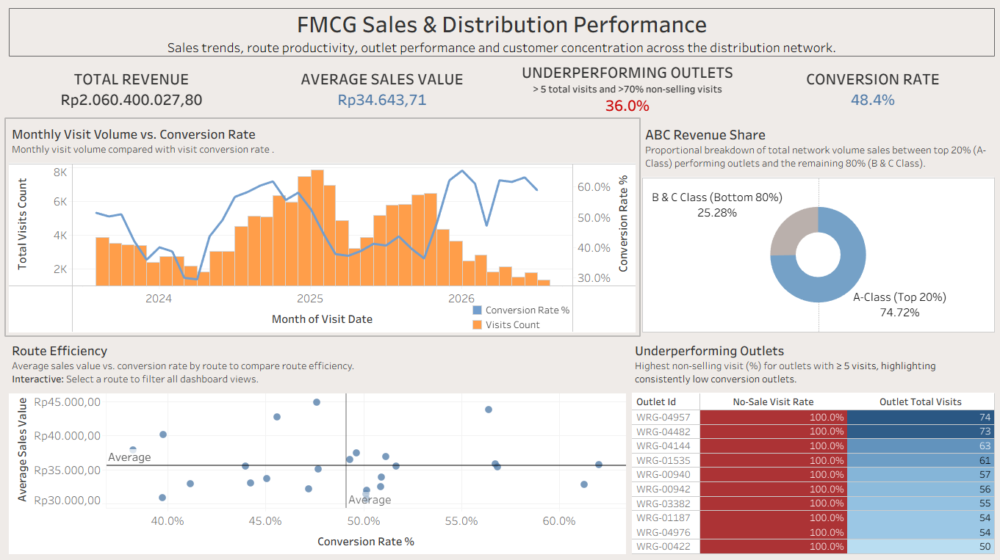
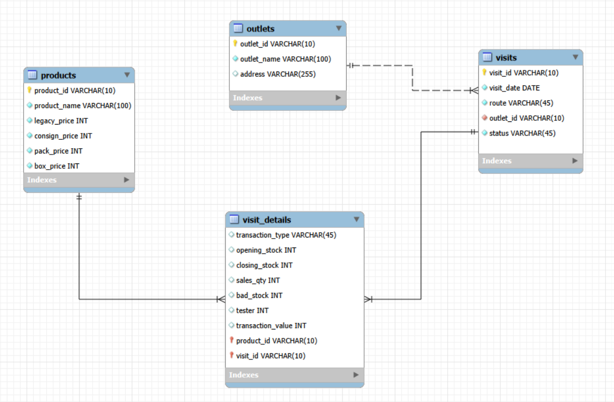

# FMCG Sales & Distribution Analysis

> **Project Objective:** This project analyzes historical sales and field visit data from an FMCG distribution business to understand business performance, sales trends, customer value, and sales force productivity.

> **Data Scope:** Outlet visits, product sales, and route activity from August 2023 to July 2026

>**Confidentiality Note:** Public-facing monetary values are scaled for confidentiality while keeping relative patterns and analytical relationships.

>**Workflow:** Python ETL → MySQL → SQL Analysis → Tableau

> **Key Business Insights:**
>* Visit efficiency improved despite lower visit volume, with visit conversion rate increasing by **22.6 percentage points (from 36.4% to 59%)** over the most recent 12 months, while total sales remained broadly stable.
>* Sales were highly concentrated, with the top **20% of outlets generating ~75% of total sales**.
>* Route-level conversion varied materially at **38.2%–62.0%**, while average sales value per successful visit was comparatively more consistent across routes.
>* Around **36% of outlets with more than 5 visits had below 30% visit conversion rate**, indicating potentially inefficient visit allocation.

> **Strategic Recommendations:**
>* Maintain a more selective visit strategy while monitoring whether further reductions in visit volume begin to constrain revenue.
>* Prioritize retention, stock availability, and service quality for high-value outlets while reassessing coverage of consistently low-contributing accounts.
>* Use high-conversion routes as benchmarks and investigate low-performing routes at the outlet level before attributing performance to salesforce execution.
>* Review frequently visited, low-conversion outlets for targeted intervention, reduced visit frequency, or customer status reassessment.

## Table of Contents
- [Project Overview](#project-overview)
    - [Project Workflow](#project-workflow)
    - [Dashboard Preview](#dashboard-preview)
- [Tools and Technologies](#tools-and-technologies)
- [Data Preparation and ETL Pipeline](#data-preparation-and-etl-pipeline)
    - [Source Data Challenges and ETL Design](#source-data-challenges-and-etl-design)
    - [ETL Processing Steps](#etl-processing-steps)
- [Data Model](#data-model)
- [Unified Sales Metric](#unified-sales-metric)
- [SQL Analysis](#sql-analysis)
- [Key Findings](#key-findings)
- [Tableau Dashboard](#tableau-dashboard)
- [Data Validation](#data-validation)
- [Data Limitations](#data-limitations)
- [Repository Structure](#repository-structure)
- [Running The Project](#running-the-project)


## Project Overview

This project analyzes the data from an FMCG distribution business that operates by sending sales force to visit different routes on a scheduled basis. The business sells products to retail outlet partners, mostly in the form of local stalls (warung).

The original data was stored across operational Excel workbooks that evolved over time and were not designed for analytical use. To facilitate the data analysis process, I built a Python ETL pipeline to standardize the source files, loaded the normalized outputs into MySQL, performed exploratory and analytical SQL analysis, and created a Tableau dashboard for business-facing reporting.

> **Data Governance & NDA Compliance**  
> To comply with strict data privacy standards and confidentiality, **no actual company data is hosted in this repository.**
>* For the Tableau dashboard: Company identifying fields, outlet names, product names, and route identifiers have been anonymized. Sales value data and product prices are scaled using random multiplier. The analytical structure and relationship have been preserved.
>* To ensure this repository remains fully reproducible, the `data/` folder contains a **synthetic mock dataset**. This synthetic data was generated via python to mirror the original excel workbooks format, allowing anyone to run the ETL and SQL pipelines locally.


### Project Workflow

- Build a reproducible ETL pipeline for inconsistent historical Excel workbooks.
- Create a normalized relational data model suitable for analysis.
- Develop consistent business metrics across legacy and current data formats.
- Analyze sales trends, product performance, customer concentration, and field productivity.
- Translate the analytical results into an interactive Tableau dashboard for stakeholder communication.

### Dashboard Preview

> **Interactive dashboard:** [https://public.tableau.com/app/profile/michel.thamrin/viz/Portfolio_FMCG_Dashboard/Dashboard]



## Tools and Technologies

- **Python** — Excel ingestion, cleaning, transformation, and export
- **MySQL** — relational storage, metric construction, validation, and analysis
- **Tableau Public** — interactive dashboard and visualization
- **Excel** — original operational data source

---

## Data Preparation and ETL Pipeline

The source data consisted of operational Excel workbooks used to record outlet visits, product activity, stock movement, and sales.

Because the reporting process changed over time, historical and current files did not share an identical structure. A Python ETL pipeline was created to dynamically detect workbook structure, standardize fields, preserve visit history, and convert repeated spreadsheet blocks into normalized analytical tables.


### Source Data Challenges and ETL Design

The operational workbooks were designed primarily for data entry rather than analysis, resulting in structural inconsistencies that required the ETL pipeline to adapt dynamically.

| Source Data Challenge | ETL Design Response |
|---|---|
| Historical and current workbook formats contained different fields. | Detect worksheet schema and apply format-specific transformation logic. |
| Header positions varied across worksheets. | Dynamically locate the actual header row instead of relying on fixed row numbers. |
| Product information was stored in repeated column blocks rather than normalized rows. | Detect product blocks and convert them into row-level product activity records. |
| Legacy records did not contain transaction values. | Reconstruct legacy sales value using `sales_qty × legacy_price` and unify it with current-format transaction values. |
| Outlet status existed only in newer files and varied by visit. | Store status at the visit level rather than treating it as a permanent outlet attribute. |
| A recorded visit did not always contain product-level activity. | Preserve `visits` independently from `visit_details` so legitimate visits without product activity are retained. |
| Blank cells were used instead of explicit zeros. | Standardize missing numeric values during transformation while preserving the distinction between no activity and recorded activity. |

### ETL Processing Steps

In addition to handling structural inconsistencies in the source workbooks, the pipeline performs the standard processing steps required to prepare the data for analysis.

| ETL Stage | Purpose |
|---|---|
| Data extraction | Read outlet, visit, and product activity records from the operational workbooks. |
| Data cleaning | Standardize dates, numeric fields, missing values, and invalid records. |
| Data transformation | Convert repeated spreadsheet structures into normalized outlet, visit, and product-detail records. |
| Data validation | Check identifier consistency, product mappings, record integrity, and numerical anomalies. |
| Export | Generate normalized CSV files for downstream loading into MySQL. |

### Example: Dynamic Structure Detection

One example of the structure-detection logic:

```python
header_row = detect_header_row(ws)

has_status_column = (
    ws.cell(row=header_row, column=4).value is not None
    and str(ws.cell(row=header_row, column=4).value).strip().lower() == "status"
)
```

Instead of assuming a fixed worksheet layout, the pipeline detects the actual header position and available fields before applying the relevant transformation logic.

---

## Data Model

The ETL process converts the original workbooks into a relational model separating customer, visit, product, and product-level visit activity.



Separating `visits` from `visit_details` preserves legitimate field visits where no product-level activity or sale was recorded.

---

## Unified Sales Metric

Legacy records did not include `transaction_value`, so a unified sales metric was created before business analysis.

For legacy records with positive sales quantity:

```text
sales_value = sales_qty × legacy_price
```

For current format records, the recorded transaction value is retained.

This logic is implemented through the MySQL view:

```sql
CREATE OR REPLACE VIEW visit_details_with_sales_value AS
SELECT
    vd.*,
    CASE
        WHEN vd.transaction_value = 0
             AND vd.sales_qty > 0
        THEN vd.sales_qty * p.legacy_price
        ELSE vd.transaction_value
    END AS sales_value
FROM visit_details AS vd
INNER JOIN products AS p
    ON vd.product_id = p.product_id;
```

The metric was validated by reconciling recorded current format sales with reconstructed legacy sales before it was used in downstream analysis.

---

## SQL Analysis

The SQL analysis was structured around the key problem statements, mainly focusing around overall business performance, customer value and salesforce efficiency.

[View the complete SQL analysis →](sql/fmcg_analytics_query.sql)

### Business Performance
**What is driving changes in overall sales performance over time?**
- Overall sales and field activity metrics
- Monthly sales trend
- Month-over-month sales growth
- Average sales value per visit

### Customer Analysis
**How concentrated is revenue across the outlet base, and which outlets represent the greatest source of sales inefficiency?**
- Customer value segmentation
- Revenue concentration
- Outlet-level sales performance
- Underperforming and non-selling outlets

### Field-Sales Analysis
**What drives differences in sales productivity across routes?**
- Route-level sales productivity
- Sales conversion rate
- Average sales value
- Visit productivity

---

## Key Findings

### 1. Visit productivity improved while visit volume declined

Over the most recent year:

- Visit count decreased steadily.
- Average sales value per visit increased.
- Total monthly sales value fluctuated rather than following a consistent upward or downward trend.

These changes aligned with adjustments to the visit frequency policy introduced in October 2025. Visit volume declined by **79.6% (from 6,484 to 1,323 visits)**, while conversion rate increased by **22.6 percentage points (from 36.4% to 59.0%)** over the same period, suggesting that the revised visit strategy improved visit efficiency. 

However, the substantial reduction in visit volume did not result in clear growth in total sales value. Monthly revenue also continued to show a positive relationship with visit volume, indicating that further reduction in visit frequency could eventually limit sales opportunities.

**Recommendation:** Maintain the more selective visit strategy while monitoring whether further reductions in visit volume begin to negatively affect monthly revenue. Visit allocation should prioritize outlets with stronger conversion potential while maintaining sufficient coverage of productive customers.

### 2. Customer revenue was strongly concentrated

| Customer Segment | Share of Outlets | Share of Sales |
|---|---:|---:|
| Top customer group | 20% | ~75% |
| Middle customer group | 30% | ~22.5% |
| Bottom customer group | 50% | ~2.5% |

The top **20% of outlets generated approximately 75% of total recorded sales**, indicating substantial revenue concentration within a relatively small portion of the customer base.

This concentration makes high-value outlets particularly important to overall sales performance, while the bottom half of the outlet base contributes comparatively little revenue.

**Recommendation:** Prioritize retention, service consistency, and inventory availability among high-value outlets while reviewing lower value outlets for growth potential. Visit frequency for consistently low-contributing outlets could also be reassessed to improve salesforce resource allocation without unnecessarily reducing coverage of strategically important accounts.


### 3. Route conversion performance varied meaningfully

Visit conversion rate by route ranged from approximately **38.2% to 62.0%**, compared with an overall network average of approximately **48.4%**.

The size of this range suggests that the likelihood of generating a sale from a visit differs meaningfully across routes. This may reflect differences in outlet quality, route composition, visit targeting, or sales execution rather than visit volume alone.

**Recommendation:** Review consistently high-conversion routes to identify practices or outlet characteristics that could be replicated elsewhere. Lower conversion routes should be examined at the outlet level to distinguish between salesforce execution issues and routes containing a larger proportion of low-potential outlets.


### 4. Average sales value varied less than conversion

Average sales value per selling visit across routes ranged from approximately **Rp15K to 22K**, with an overall average of approximately **Rp17.7K**.

Compared with the wider variation in route conversion rates, differences in average order value were relatively moderate. This suggests that route-level performance differences are driven more strongly by whether visits convert into sales than by large differences in transaction value once a sale occurs.

**Recommendation:** Route improvement efforts should initially focus on increasing visit conversion rather than solely attempting to increase order size. Once conversion performance improves, product mix and cross-selling opportunities can be evaluated to increase the value generated from successful visits.


### 5. A sizable share of frequently visited outlets generated limited sales

Among outlets with **more than five recorded visits**, approximately **36% had a visit conversion rate below 30%**.

These outlets received repeated salesforce coverage but converted fewer than three out of every ten visits into recorded sales. Their relatively high visit frequency combined with low conversion suggests a potential opportunity to improve visit allocation and outlet targeting.

Not all low-conversion outlets should automatically be considered unproductive, as some may have strategic value, irregular purchasing cycles, or other reasons for requiring continued coverage.

**Recommendation:** Review these outlets individually to identify whether they should receive targeted sales intervention, reduced visit frequency, or reassessment of their active customer status. Outlets with persistently low conversion and limited sales contribution represent the strongest candidates for visit frequency optimization.


---

## Tableau Dashboard

The Tableau dashboard translates the SQL findings into an interactive business-facing view, allowing users to explore performances across time, routes, and outlets.

Dashboard components include:

- Business overview KPIs
- Monthly sales and conversion rate trend
- Monthly visit volume
- Average sales value per visit
- Customer value concentration
- Route conversion vs. average sales value
- Interactive route filtering

---

## Data Validation

Before analysis, the transformed data was checked for:

- record count consistency
- primary key uniqueness
- product mapping validity
- date range consistency
- numerical anomalies
- missing transaction values
- legitimate visits without product-detail activity

Validation also confirmed that visits without detail records represented genuine recorded field activity rather than ETL failures.

---

## Data Limitations

- Historical and current workbook formats do not contain identical fields.
- Outlet status is unavailable for a substantial portion of historical records.
- The source process is primarily designed around repeat-order activity, so the absence of recorded sales does not necessarily mean an outlet has never purchased.
- Some outlets legitimately appear across multiple routes over time.
- Findings therefore represent the available recorded operational data rather than a complete representation of every commercial transaction.

---

## Repository Structure

```text
fmcg-sales-analysis/
│
├── README.md
├── requirements.txt
├── .gitignore
├──input/
│   ├── mock_route_x.xlsx
│   └── mock_route_y.xlsx
├──reference-data/
│   ├── products.xlsx
├── src/
│   ├── config.py
│   ├── read_excel.py
│   ├── utils.py
│   └── validator.py
│
├──output/ 
│   └── .gitkeep
│
├── sql/
│   └── fmcg_analysis.sql
│
│
└── images/
    ├── database_schema.png
    └── dashboard_preview.png

```

---

## Running the ETL Pipeline

A pre-generated synthetic dataset is included in this repository so the ETL pipeline can be tested without exposing confidential company data. The mock Excel workbooks reproduce the structural characteristics of the original operational files, including differences between historical and current workbook formats.

> **Note:** The synthetic dataset is intended only to demonstrate and test the ETL pipeline. The SQL analysis and Tableau dashboard were developed using masked and scaled versions of the original operational data and therefore will not reproduce the same analytical results when using the mock dataset.

### 1. Install Dependencies

Create and activate a Python virtual environment, then install the required packages:

```bash
pip install -r requirements.txt
```

### 2. Run the ETL Pipeline

The synthetic Excel workbooks are provided in the `input/` folder.

Run:

```bash
python src/read_excel.py
```

The pipeline reads the source workbooks, detects their structure, standardizes the data, and generates normalized CSV outputs.

Expected outputs include:

```text
output/
├── outlets.csv
├── visits.csv
├── visit_details.csv
└── review_items.csv
```

`review_items.csv` contains records requiring manual review, including intentionally introduced product-name inconsistencies in the synthetic source data.

The generated outputs demonstrate the normalized data structure used by the downstream database and analytical workflow.

---